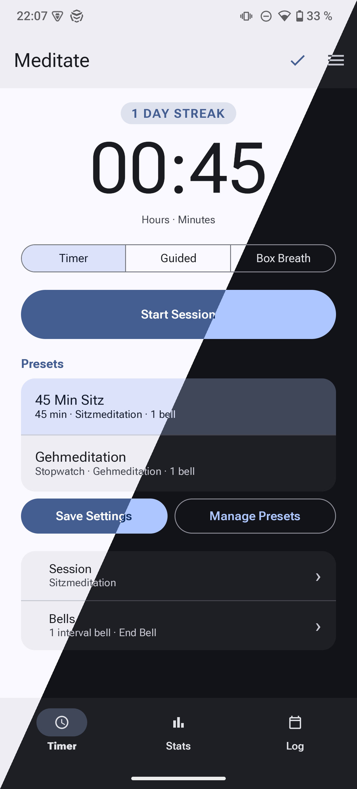
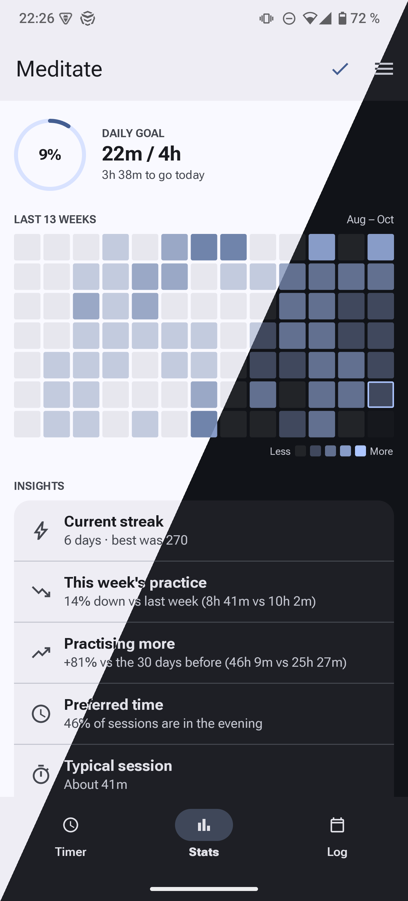
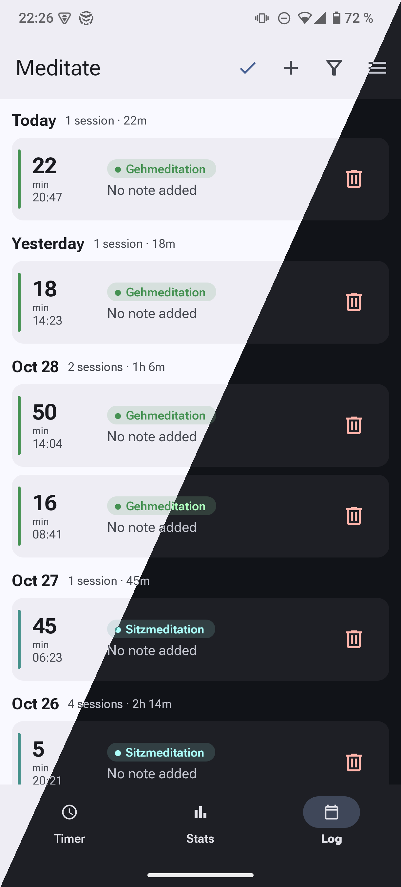
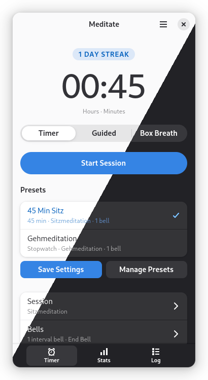
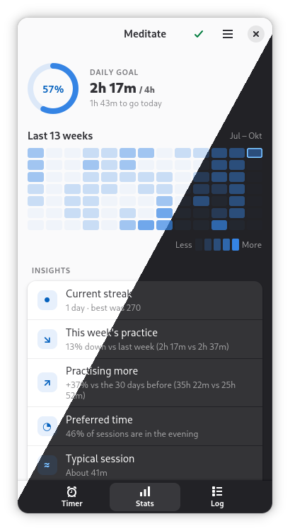
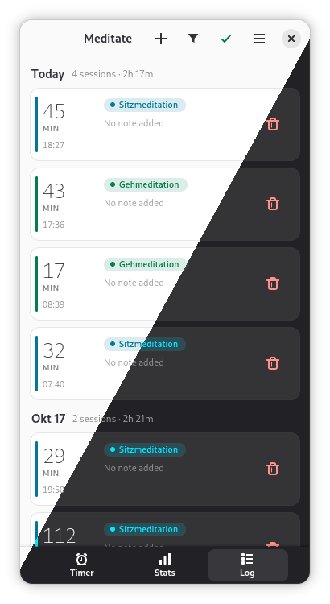

<p align="center">
  
</p>

<h1 align="center">Meditate</h1>

<p align="center">
  A meditation timer and session log
  <br><b>for Android and Linux</b>.
</p>

<p align="center">
  <a href="https://github.com/janekbt/MeditationApp/releases"></a>
  <a href="COPYING"></a>
</p>

<p align="center">
  <a href="https://f-droid.org/packages/io.github.janekbt.Meditate/"></a>
  <a href="https://flatpark.org/apps/io.github.janekbt.Meditate/"></a>
  <a href="https://github.com/janekbt/MeditationApp/releases/latest"></a>
</p>

---

Meditate is a **timer and session log** that helps you build a **consistent practice**.

It runs **natively on Android** as well as on **Linux desktops and Linux phones**, and offers
optional sync to **your own, private Nextcloud**. No tracking, no ads, no account.

---

## Contributing

Contributions are welcome, but please read the guidelines first: [CONTRIBUTING.md](CONTRIBUTING.md)

---

## Translations

Meditate is translated into 10 languages (English, German, Spanish, French, Italian, Dutch,
Polish, Brazilian Portuguese, Russian, Simplified Chinese) on Linux and Android alike.
How to add or update a translation: [BUILDING.md](BUILDING.md#translations)

---

## Screenshots

| | Timer | Stats | Log |
|---|---|---|---|
| **Android** |  |  |  |
| **Linux** |  |  |  |

---

## Features

- **Four modes**: countdown, stopwatch, Box Breath and Guided, which plays your own recordings
- **Bells**: starting, interval and end bells as sound, vibration or both, with your own sounds and a volume for each
- **Presets** for one-tap starts, in your own order
- **Session log** with labels and notes, filters, and undo
- **Stats**: a 13-week heatmap, a daily goal, charts and a breakdown per label
- **Import and backup**: Insight Timer and Meditation Assistant import, CSV export and import
- **Sync between all your devices** through your own Nextcloud, offline-first, never losing a session
- **Session controls on the lock screen** with the time left and a progress bar, on Android and on Linux (GNOME, Phosh)
- **On Android**: a home-screen widget, and experimental Void-Controls: turn the phone face down to pause, shake it to save
- **Follows your system colours** on Linux and Android
- **Private**: everything stays on your device, no tracking, open source under GPLv3

---

## Compatibility

Meditate runs on:
- **Android 8.0+**
- **Linux** on **x86_64** and **aarch64**:
  - with **Flatpak**
  - without Flatpak, built from source, with **GTK 4.18+** and **libadwaita 1.7+**

---

## Technical details

Meditate uses:

- [Rust](https://www.rust-lang.org/) for all three crates; the shared [`meditate-core`](meditate-core/README.md) holds persistence, sync and session logic
- [GTK 4](https://www.gtk.org/) and [libadwaita](https://gnome.pages.gitlab.gnome.org/libadwaita/) for the Linux app, with [GStreamer](https://gstreamer.freedesktop.org/) for sound
- [Slint](https://slint.dev/) with its Material 3 widgets for the Android app
- [SQLite](https://www.sqlite.org/) (through [rusqlite](https://github.com/rusqlite/rusqlite)) for the session database
- [WebDAV](https://docs.nextcloud.com/server/latest/user_manual/en/files/access_webdav.html) for Nextcloud sync

See [ARCHITECTURE.md](ARCHITECTURE.md) for the full map.

---

## Installation

### Android

<a href="https://f-droid.org/packages/io.github.janekbt.Meditate/"></a>

Install **[Meditate from F-Droid](https://f-droid.org/packages/io.github.janekbt.Meditate/)**.
F-Droid rebuilds every release from source and verifies it matches the APK
published here, so you get the same signed app either way; updates arrive
through F-Droid.

The APK is also attached to every [release](../../releases) as
`Meditate-<version>.apk` (same signature as F-Droid's — the two update each
other). Unreleased builds from CI (`meditate-android.apk` on the
[Actions](../../actions) page) are signed with a throwaway debug key: they
can't update an installed release, and installing one over a release
requires uninstalling it first, which deletes the app's data.

### Linux (FlatPark)

<a href="https://flatpark.org/apps/io.github.janekbt.Meditate/"></a>

Install **[Meditate from FlatPark](https://flatpark.org/apps/io.github.janekbt.Meditate/)**,
a signed Flatpak remote, for **x86_64** and **aarch64**. It ships the same
build as the release bundles below, and updates arrive with `flatpak update`
or your software centre.

```sh
flatpak --user remote-add --if-not-exists flatpark https://dl.flatpark.org/flatpark.flatpakrepo
flatpak --user remote-add --if-not-exists flathub https://dl.flathub.org/repo/flathub.flatpakrepo  # provides the GNOME 51 runtime
flatpak --user install flatpark io.github.janekbt.Meditate
```

Coming from a release bundle? Uninstall it first with
`flatpak uninstall io.github.janekbt.Meditate`; both use the same app id, and
your sessions and settings in `~/.var/app/io.github.janekbt.Meditate` stay.

### Linux (Flatpak bundle)

<a href="https://github.com/janekbt/MeditationApp/releases/latest"></a>

Pre-built Flatpak bundles for **x86_64** and **aarch64** are attached to every
[release](../../releases) as `meditate-<version>-<arch>.flatpak`. (Flathub is
not an option for this app.) CI runs attach the same bundles on the
[Actions](../../actions) page for unreleased builds; those expire after 90
days and need a GitHub login.

```sh
flatpak remote-add --if-not-exists --user flathub https://dl.flathub.org/repo/flathub.flatpakrepo  # provides the GNOME 51 runtime
flatpak install --user meditate-<version>-<arch>.flatpak
flatpak run io.github.janekbt.Meditate
```

### Building from source

```sh
./build.sh gtk --debug       # Linux app → ./meditate-gtk/builddir/src/meditate
./build.sh android --debug   # Android APK → meditate-android/android/app/build/outputs/apk/debug/app-debug.apk
```

Drop `--debug` for optimized builds. `build.sh` installs missing
dependencies on Debian/Ubuntu, Fedora and Arch (it asks for your password
once) and checks the GTK 4.18 / libadwaita 1.7 floor before compiling. For
Android it also installs rustup and, if you have none, a JDK 17. See
[`BUILDING.md`](BUILDING.md#android-toolchain), which is the full reference:
prerequisites, the Flatpak build, tests, translations, testing on a phone,
and CI.

The workspace has three crates: the portable
[`meditate-core`](meditate-core/README.md) (persistence, sync and session
logic — most non-UI contributions land here), the GTK app in
[`meditate-gtk/`](meditate-gtk/) and the Android app in
[`meditate-android/`](meditate-android/). See
[`ARCHITECTURE.md`](ARCHITECTURE.md) for the full map.

## Data

Sessions and settings are stored in a SQLite database at
`~/.local/share/meditate/meditate.db` (or the Flatpak equivalent
inside the sandbox). On Android it lives in the app's private
storage; use the CSV export or Nextcloud sync to get data out.

## Privacy

No telemetry, no analytics, no accounts. Your sessions live in a
local SQLite database on your device. Network access happens only
if you configure sync against your own Nextcloud, and only to that
server. On Android, cloud backup of the database is disabled — the
supported backup paths are your Nextcloud and the CSV export.

## License

Meditate is free software released under the [GNU General Public License v3.0 or later](COPYING).
