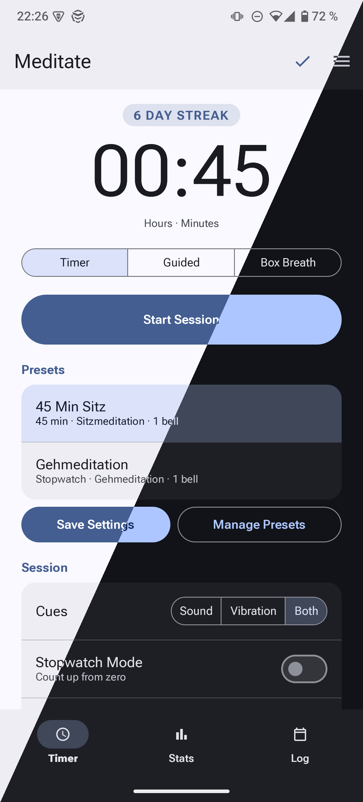
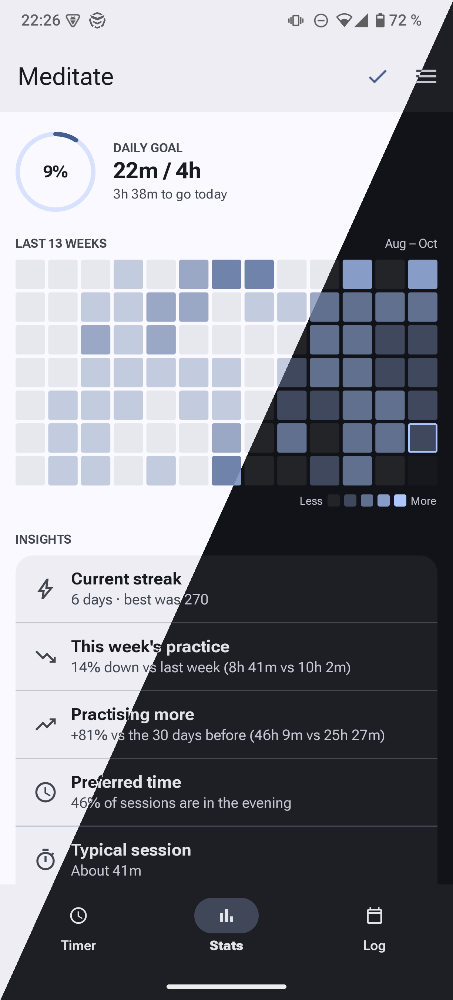
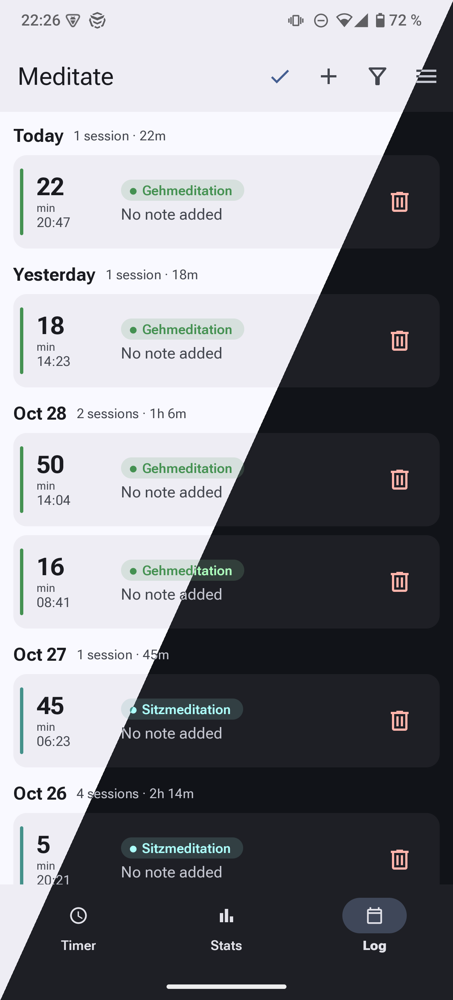
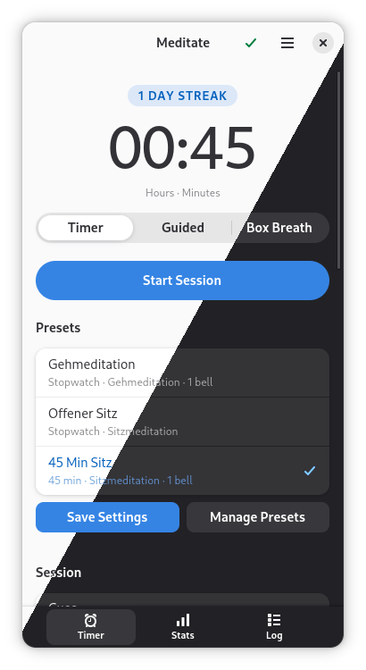
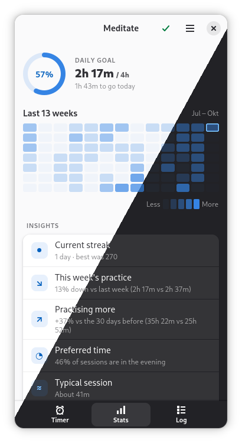
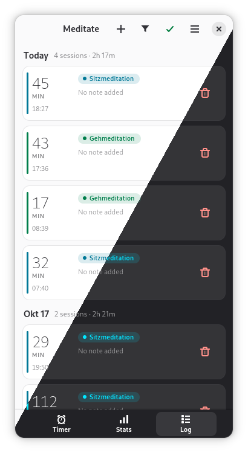

# Meditate

A meditation timer and session log for Android and Linux.

Countdown and stopwatch, a browsable log, and daily-goal stats to help you build a consistent practice. Adaptive for desktop and Linux phones, with a native Android app that syncs over your own Nextcloud.

<a href="https://f-droid.org/packages/io.github.janekbt.Meditate/"></a>

## Screenshots

Android:

<p>
  
  
  
</p>

Linux:

<p>
  
  
  
</p>

## Features

### Timer
- Countdown, stopwatch, Box Breath, and Guided modes
- Box Breath: start from the 4-4-4-4 or 4-7-8-0 preset or set each phase yourself, with an optional sound or vibration cue for each phase; the running view traces a dot around an accent-tinted square as you breathe in, hold, out, hold
- Guided: play your own guided-meditation audio; the end bell rings when the track finishes. Imported files go into a library where you star the ones you use; files that aren't Ogg (WAV, MP3 and so on) are converted on import. Or link a local folder you manage yourself: browse it by folder or as one list sorted by name, length or plays, star files, and play them in place without copying (stays on that device)
- Bells: an optional starting bell, interval bells (at fixed times, or repeating every so many seconds or minutes, randomised around each planned time or with gaps that grow on each ring), and a per-mode end bell — each as sound, vibration, or both, with bundled or imported sounds, a volume slider for every bell, and a visual vibration-pattern editor; on Android bells play as media, so with headphones they ring only there, or as an alarm for devices where they fail (Preferences); an optional wake-up lead-in, a soft noise before each bell, keeps sleeping Bluetooth headphones and speakers from swallowing it, in both apps
- Optional preparation time before the starting bell
- While a Timer or Guided session runs, a ring round the time fills with the session and shows each bell as a bead, and the bells, the starting and end bell included, are counted under the time ("2 of 5")
- The computer or phone stays awake during a session so bells ring on time; keeping the screen on too is set per mode
- Quick presets plus custom durations; drag presets into your own order on the Manage page; editing an interval bell a preset rings makes it a new bell, so the preset keeps ringing the bell it was saved with
- Per-mode labels: each mode remembers the label you last used for it
- One screen from start to end: pause, resume, save or discard right on the running page, with an optional note; Save sits next to Pause, so you can stop early in one tap
- Auto-Finish per mode: a countdown saves itself when the time is up, with Undo
- Daily streak and a system notification when you're away from the app

### Log
- Date-grouped card feed of every session, naming the guided file each one played
- Filter by label, or sessions with notes
- Add, edit, or delete sessions, with undo
- Import from Insight Timer, and CSV import/export for backups

### Stats
- 13-week contribution heatmap, with stars for days that cleared your daily goal
- Daily-goal ring showing today's progress
- Bar or line chart across week / month / 3 months / year
- Per-label breakdown: totals and session counts for each label
- Streak, total time, and session count at a glance
- Insight cards: trend against last week and the previous 30 days, preferred time of day, typical and longest session, next milestone

### Sync
- Optional sync between all your devices — Linux and Android — via your own Nextcloud (WebDAV, app password)
- Sessions, labels, presets, preferences and your imported sounds and guided files sync
- Update every device that syncs together: an older version that changes an interval bell drops what it doesn't know about it, such as a growing gap or a time in seconds, and changes the bell a preset rings instead of making a new one
- Offline-first: everything works without a network; changes merge whenever you're back online, with conflict handling that never loses a session

### Preferences
- Daily goal; CSV backup and restore, Insight Timer import, Nextcloud sync settings, delete all sessions
- On Android, follow the system colours (Android 14+) or pick an accent colour
- Labels, presets, bell sounds and vibration patterns are managed from the timer setup

### Android app
- Native Android port (Slint + Material 3) in [`meditate-android/`](meditate-android/): the same modes, log, stats, presets, and Nextcloud sync on your phone, sharing the identical `meditate-core` logic — a session recorded on one device converges to all of them
- Home-screen widget for one-tap preset starts, in your system colours on Android 12 and later, a themed app icon on Android 13 and later, foreground-service timer that survives screen-off, with Pause, Resume, Save and Discard in its media control on the lock screen and the headphones' play/pause button, guided-audio import with on-device Opus transcode
- On [F-Droid](https://f-droid.org/packages/io.github.janekbt.Meditate/); build instructions in [`BUILDING.md`](BUILDING.md#android)

### General
- Translated into 10 languages (English, German, Spanish, French, Italian, Dutch, Polish, Brazilian Portuguese, Russian, Simplified Chinese) — on Linux and Android alike
- Keyboard shortcuts for the common actions on Linux
- Dark-mode and high-contrast safe; follows your system accent colour on Linux, and your wallpaper's colours on Android 14 and later, or pick from six accent colours in the app; the Log's label colours follow the accent
- About → Troubleshooting view with a rolling diagnostics log, for attaching to bug reports
  - Log file lives at `~/.var/app/io.github.janekbt.Meditate/data/meditate/diagnostics.log` on Flatpak, `~/.local/share/meditate/diagnostics.log` otherwise — useful when the About dialog itself can't be opened

## Installation

### Android

<a href="https://f-droid.org/packages/io.github.janekbt.Meditate/"></a>

Install **[Meditate from F-Droid](https://f-droid.org/packages/io.github.janekbt.Meditate/)**.
F-Droid rebuilds every release from source and verifies it matches the APK
published here, so you get the same signed app either way; updates arrive
through F-Droid.

The APK is also attached to every [release](../../releases) as
`Meditate-<version>.apk` (same signature as F-Droid's — the two update each
other). Unreleased builds from CI (`meditate-android.apk` on the
[Actions](../../actions) page) are signed with a throwaway debug key: they
can't update an installed release, and installing one over a release
requires uninstalling it first, which deletes the app's data.

### Linux (Flatpak)

Pre-built Flatpak bundles for **x86_64** and **aarch64** are attached to every
[release](../../releases) as `meditate-<version>-<arch>.flatpak`. (Flathub is
not an option for this app.) CI runs attach the same bundles on the
[Actions](../../actions) page for unreleased builds; those expire after 90
days and need a GitHub login.

```sh
flatpak remote-add --if-not-exists --user flathub https://dl.flathub.org/repo/flathub.flatpakrepo  # provides the GNOME 51 runtime
flatpak install --user meditate-<version>-<arch>.flatpak
flatpak run io.github.janekbt.Meditate
```

### Building from source

```sh
./build.sh gtk --debug       # Linux app → ./meditate-gtk/builddir/src/meditate
./build.sh android --debug   # Android APK → meditate-android/android/app/build/outputs/apk/debug/app-debug.apk
```

Drop `--debug` for optimized builds. `build.sh` installs missing
dependencies on Debian/Ubuntu, Fedora and Arch (it asks for your password
once) and checks the GTK 4.18 / libadwaita 1.7 floor before compiling. The
Android build needs **JDK 17 exactly** and rustup installed first. See
[`BUILDING.md`](BUILDING.md#android-toolchain), which is the full reference:
prerequisites, the Flatpak build, tests, translations, testing on a phone,
and CI.

The workspace has three crates: the portable
[`meditate-core`](meditate-core/README.md) (persistence, sync and session
logic — most non-UI contributions land here), the GTK app in
[`meditate-gtk/`](meditate-gtk/) and the Android app in
[`meditate-android/`](meditate-android/). See
[`ARCHITECTURE.md`](ARCHITECTURE.md) for the full map.

## Data

Sessions and settings are stored in a SQLite database at
`~/.local/share/meditate/meditate.db` (or the Flatpak equivalent
inside the sandbox). On Android it lives in the app's private
storage; use the CSV export or Nextcloud sync to get data out.

## Privacy

No telemetry, no analytics, no accounts. Your sessions live in a
local SQLite database on your device. Network access happens only
if you configure sync against your own Nextcloud, and only to that
server. On Android, cloud backup of the database is disabled — the
supported backup paths are your Nextcloud and the CSV export.

## License

Meditate is free software released under the [GNU General Public License v3.0 or later](COPYING).
